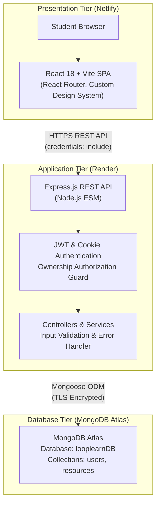

# LoopLearn — Student Resource Exchange Platform

> **"Pass it on. Learn more."**  
> A dedicated, student-centered platform engineered to circulate educational resources—textbooks, revision notes, lab equipment, and calculators—across campus communities to reduce avoidable academic expenses and eliminate waste.

---

## 1. Project Overview & Problem Statement

Every semester, students purchase expensive textbooks, laboratory coats, revision guides, and scientific calculators that are often used for only a few months before gathering dust or being discarded. Simultaneously, incoming students face escalating education costs and struggle to access essential coursework materials.

**LoopLearn** bridges this gap as an independent campus circular and exchange network. It provides students with a trusted platform to discover, donate, exchange, or lend verified educational resources without commercial intermediaries, shopping carts, or fees.

### Non-Commercial Platform Philosophy
- **Donate:** Hand over usable materials to fellow students completely free.
- **Exchange:** Trade textbooks or gear for desired resources (e.g., swapping a calculus book for an algorithms guide).
- **Lend:** Make equipment or calculators temporarily available during exam or semester periods with clear return expectations.
- **Zero Commercial Bloat:** No payment gateways, delivery markups, or subscription locks. Exchanges are arranged directly between students on campus.

---

## 2. Key Features

- **The Campus Circular Hero:** Art-directed, editorial interface styled like a modern campus publication with handcrafted SVG illustration artwork (books, notebook, pencil, plant, and circulation motifs).
- **Real-Time Resource Discovery:** Fast search by title and description, instant filtering by category (*Textbooks, Study Notes, Calculators & Electronics, Lab & Academic Supplies, Other*), offer type (*Donate, Exchange, Lend*), condition (*New, Like New, Good, Fair*), and sorting.
- **Dedicated Resource Details:** Comprehensive view with condition tags, campus pickup locations, public contact methods, and offer-specific expectations (exchange preferences and borrowing duration).
- **Secure Authentication & Ownership:** JWT-based student authentication with HttpOnly cookies, Bcrypt password hashing, and server-enforced listing authorization.
- **Listing Management Dashboard ("My Listings"):** Authenticated students can view all their active listings, edit listing details or availability via modal dialogs, and delete listings with confirmation safeguards.
- **Robust Security & Input Validation:** Centralized rate limiting, Helmet HTTP security headers, explicit CORS origin protection, NoSQL injection prevention, and strict validation schemas.
- **Responsive & Accessible Design:** Mobile-responsive navigation drawer, semantic HTML5, accessible dialogs with focus trapping and ESC handling, restrained hover micro-interactions (3–4px lift), and `prefers-reduced-motion` compliance.

---

## 3. System Architecture

LoopLearn implements a decoupled, modern three-tier architecture:



### Separation of Responsibilities
1. **Presentation Tier (Frontend):** Renders pages, collects user input, coordinates client validation, issues authenticated fetch requests to the REST API, and displays loading, empty, and error feedback. Never accesses MongoDB directly.
2. **Application Tier (Backend):** Sanitizes and validates request payloads, enforces business logic, signs and verifies authentication tokens, verifies resource ownership before updates/deletions, and emits standardized JSON responses. Keeps all secrets and database access strings server-side.
3. **Database Tier (Database):** Persists normalized student records and academic resource listings with unique constraints and indexing.

---

## 4. Technology Stack

| Layer | Technologies & Libraries |
| :--- | :--- |
| **Frontend** | React 18, Vite, React Router v6, Lucide React, Vanilla CSS Design System, Fetch API |
| **Backend** | Node.js (ES Modules), Express.js, Mongoose 8, BcryptJS, JSONWebToken, Cookie-Parser, Helmet, CORS, Express-Rate-Limit |
| **Database** | MongoDB Atlas (Production) / MongoDB Community Server (Local development) |
| **Testing** | Vitest, Supertest |
| **Code Quality** | ESLint 9 |
| **Hosting & CI/CD**| Netlify (Frontend SPA), Render (Backend Web Service) |

---

## 5. Repository Structure

```text
LoopLearn/
├── backend/
│   ├── scripts/
│   │   └── seed.js                   # Development database seed script
│   ├── src/
│   │   ├── config/
│   │   │   ├── database.js           # Mongoose connection & lifecycle events
│   │   │   └── env.js                # Environment variable validator (fail-fast)
│   │   ├── controllers/
│   │   │   ├── auth.controller.js    # Register, login, logout, getMe
│   │   │   └── resource.controller.js# Resource CRUD controllers
│   │   ├── middleware/
│   │   │   ├── authenticate.js       # JWT & HttpOnly cookie verification
│   │   │   ├── authorizeResourceOwner.js # Resource ownership verification guard
│   │   │   ├── errorHandler.js       # Centralized error handler
│   │   │   └── notFound.js           # 404 route handler
│   │   ├── models/
│   │   │   ├── Resource.js           # Resource schema & indexes
│   │   │   └── User.js               # Student user schema & password methods
│   │   ├── routes/
│   │   │   ├── auth.routes.js        # Auth router & brute-force rate limiter
│   │   │   └── resource.routes.js    # Resource router
│   │   ├── services/
│   │   │   ├── auth.service.js       # Auth business logic & token signing
│   │   │   └── resource.service.js   # Resource query, filter, & CRUD logic
│   │   ├── utils/
│   │   │   ├── apiError.js           # Custom operational error class
│   │   │   └── asyncHandler.js       # Async middleware wrapper
│   │   ├── validators/
│   │   │   ├── auth.validator.js     # Auth input validation
│   │   │   └── resource.validator.js # Resource business rules & payload validator
│   │   ├── app.js                    # Express app configuration & middleware
│   │   └── server.js                 # HTTP server listener & graceful shutdown
│   ├── tests/
│   │   ├── auth.test.js              # Authentication integration test suite
│   │   └── resources.test.js         # Resource CRUD & ownership test suite
│   ├── .env.example
│   ├── .gitignore
│   └── package.json
│
├── frontend/
│   ├── public/
│   │   └── favicon.svg               # Circular leaf/book brand favicon
│   ├── src/
│   │   ├── app/
│   │   │   ├── App.jsx               # Root application & layout structure
│   │   │   └── router.jsx            # React Router route definitions
│   │   ├── assets/
│   │   │   └── illustrations/
│   │   │       ├── CampusIllustration.jsx # Handcrafted SVG editorial artwork
│   │   │       └── CategoryIllustration.jsx # Category iconography
│   │   ├── components/
│   │   │   ├── layout/
│   │   │   │   ├── Footer.jsx        # Compact campus footer
│   │   │   │   ├── Navbar.jsx        # Responsive navigation & auth controls
│   │   │   │   └── PageContainer.jsx # Centered max-width container
│   │   │   ├── resources/
│   │   │   │   ├── ResourceCard.jsx  # Card with hover lift & tags
│   │   │   │   ├── ResourceFilters.jsx# Search & filter controls
│   │   │   │   ├── ResourceForm.jsx  # Reusable listing creation & edit form
│   │   │   │   ├── ResourceGrid.jsx  # Responsive grid & empty states
│   │   │   │   └── ResourceStatusBadge.jsx # Badges for offer, condition, status
│   │   │   └── ui/
│   │   │       ├── Button.jsx        # Styled button with loading state
│   │   │       ├── EmptyState.jsx    # Accessible empty state UI
│   │   │       ├── ErrorMessage.jsx  # Alert message with retry trigger
│   │   │       ├── Input.jsx         # Form input with validation state
│   │   │       ├── LoadingState.jsx  # Accessible spinner & feedback
│   │   │       ├── Modal.jsx         # Accessible modal dialog
│   │   │       ├── Select.jsx        # Styled select dropdown
│   │   │       └── Textarea.jsx      # Multi-line textarea
│   │   ├── context/
│   │   │   └── AuthContext.jsx       # Student authentication context
│   │   ├── hooks/
│   │   │   ├── useAuth.js            # Auth hook
│   │   │   └── useResources.js       # Resource query & filter hook
│   │   ├── pages/
│   │   │   ├── CreateResourcePage.jsx# Listing creation page
│   │   │   ├── DiscoverPage.jsx      # Main landing & resource discovery
│   │   │   ├── LoginPage.jsx         # Student login
│   │   │   ├── MyListingsPage.jsx    # Dashboard for owned resources
│   │   │   ├── NotFoundPage.jsx      # 404 error page
│   │   │   ├── RegisterPage.jsx      # Student registration
│   │   │   └── ResourceDetailsPage.jsx # Dedicated item details
│   │   ├── services/
│   │   │   ├── api.js                # Centralized fetch wrapper
│   │   │   ├── auth.api.js           # Auth endpoint client
│   │   │   └── resources.api.js      # Resource endpoint client
│   │   ├── styles/
│   │   │   ├── components.css        # Rich component styling
│   │   │   ├── global.css            # Resets, typography, & layouts
│   │   │   └── tokens.css            # Editorial color palette & design tokens
│   │   ├── utils/
│   │   │   ├── formatDate.js         # Relative & academic date formatter
│   │   │   └── validation.js         # Client-side form validation
│   │   ├── index.html
│   │   └── main.jsx                  # React entry point
│   ├── eslint.config.js
│   ├── netlify.toml                  # Netlify build configuration & SPA redirects
│   ├── vite.config.js
│   ├── .env.example
│   ├── .gitignore
│   └── package.json
│
├── render.yaml                       # Render Infrastructure-as-Code blueprint
├── package.json                      # Root workspace scripts
├── .gitignore
└── README.md
```

---

## 6. Prerequisites

- **Node.js:** v18.0.0 or higher (v22.x recommended)
- **npm:** v9.x or higher
- **MongoDB:** A running local MongoDB instance or a free [MongoDB Atlas](https://www.mongodb.com/atlas) cluster

---

## 7. Local Installation & Development

### Step 1: Clone the Repository
```bash
git clone https://github.com/muleysayali875-ui/LoopLearn.git
cd LoopLearn
```

### Step 2: Install Dependencies
Install dependencies for both backend and frontend using root npm workspaces:
```bash
npm install
```

### Step 3: Configure Environment Variables

**Backend:**
Create a `.env` file in `backend/`:
```env
PORT=5000
NODE_ENV=development
MONGODB_URI=mongodb://127.0.0.1:27017/looplearnDB
FRONTEND_URL=http://localhost:5173
JWT_SECRET=super_secret_development_key_at_least_32_characters_long
JWT_EXPIRES_IN=7d
COOKIE_SECURE=false
```

**Frontend:**
Create a `.env` file in `frontend/`:
```env
VITE_API_BASE_URL=http://localhost:5000/api
```

### Step 4: Seed Development Data
Seed the local database with realistic sample campus resources and demo student accounts:
```bash
npm run seed --workspace=backend
```
*Demo Accounts seeded:*
- `alex.rivera@campus.edu` / `student123`
- `maya.chen@campus.edu` / `student123`
- `priya.patel@campus.edu` / `student123`
- `jordan.taylor@campus.edu` / `student123`

### Step 5: Start the Development Servers
In two separate terminal windows (or concurrently):

**Terminal 1 — Backend API:**
```bash
npm run server
# API starts at http://localhost:5000
```

**Terminal 2 — Frontend Client:**
```bash
npm run dev
# Frontend starts at http://localhost:5173
```

Visit **`http://localhost:5173`** in your browser.

---

## 8. Environment Variable Reference

### Backend (`backend/.env`)

| Variable | Description | Safe Example / Placeholder |
| :--- | :--- | :--- |
| `PORT` | Port number Express listens on | `5000` (Local) / `10000` (Render) |
| `NODE_ENV` | Runtime environment mode | `development` or `production` |
| `MONGODB_URI` | MongoDB Atlas TLS connection string | `mongodb+srv://<user>:<password>@cluster.mongodb.net/looplearnDB?retryWrites=true&w=majority` |
| `FRONTEND_URL` | Deployed frontend origin for CORS | `https://looplearn-campus.netlify.app` |
| `JWT_SECRET` | Secret key for signing JWT tokens (min 32 chars) | `<generate-strong-random-key>` |
| `JWT_EXPIRES_IN` | Token expiration duration | `7d` |
| `COOKIE_SECURE` | Enforce HTTPS Secure flag on cookies | `true` in production, `false` in local development |

### Frontend (`frontend/.env`)

| Variable | Description | Safe Example / Placeholder |
| :--- | :--- | :--- |
| `VITE_API_BASE_URL` | Base URL for REST API endpoints | `http://localhost:5000/api` (Local) / `https://looplearn-api.onrender.com/api` (Production) |

---

## 9. MongoDB Atlas Setup Guide

1. **Sign Up / Log In:** Visit [MongoDB Atlas](https://www.mongodb.com/atlas) and create a free Shared Cluster (M0).
2. **Create Database User:**
   - Under **Database Access**, click **Add New Database User**.
   - Select Password Authentication.
   - Choose username (e.g., `looplearn_admin`) and a secure password.
   - Set Built-in Role to **Read and write to any database**.
3. **Configure Network Access:**
   - Under **Network Access**, click **Add IP Address**.
   - For local development: Add your current IP address.
   - For Render deployment: Add Render's outbound IPs or `0.0.0.0/0` (Allow Access from Anywhere) with strong password authentication.
4. **Obtain Connection String:**
   - Go to **Database > Clusters > Connect**.
   - Select **Drivers (Node.js)**.
   - Copy the URI and replace `<password>` and the database name with `looplearnDB`:
     ```text
     mongodb+srv://looplearn_admin:<password>@cluster0.abcde.mongodb.net/looplearnDB?retryWrites=true&w=majority
     ```
   - Set this string in the Render Dashboard environment variables (`MONGODB_URI`).

---

## 10. REST API Documentation

### Health Check
- **`GET /api/health`**
  - Returns service status, environment, timestamp, and server uptime.

### Authentication Endpoints
- **`POST /api/auth/register`**
  - **Body:** `{ "name": "...", "email": "...", "password": "..." }`
  - **Response (201):** `{ "status": "success", "data": { "user": { ... }, "token": "..." } }`
- **`POST /api/auth/login`**
  - **Body:** `{ "email": "...", "password": "..." }`
  - **Response (200):** `{ "status": "success", "data": { "user": { ... }, "token": "..." } }`
- **`POST /api/auth/logout`**
  - **Response (200):** Clears authentication cookie.
- **`GET /api/auth/me`** *(Protected)*
  - **Headers:** `Authorization: Bearer <token>` or HttpOnly Cookie
  - **Response (200):** Returns current student profile.

### Resource Endpoints
- **`GET /api/resources`**
  - **Query Params:** `search`, `category`, `offerType`, `condition`, `availability`, `sort` (`newest`, `oldest`, `title_asc`, `title_desc`), `page`, `limit`.
  - **Response (200):** `{ "status": "success", "data": { "resources": [...], "pagination": { "total": 8, "page": 1, "totalPages": 1 } } }`
- **`GET /api/resources/:id`**
  - **Response (200):** Single resource with owner public name and contact info.
- **`POST /api/resources`** *(Protected)*
  - **Body:** `{ "title": "...", "category": "...", "offerType": "...", "condition": "...", "description": "...", "location": "...", "exchangePreference": "...", "borrowDuration": "...", "contactMethod": "..." }`
  - **Response (201):** Newly created resource record.
- **`GET /api/resources/mine`** *(Protected)*
  - **Response (200):** All listings belonging to the authenticated student.
- **`PATCH /api/resources/:id`** *(Protected, Ownership Enforced)*
  - **Body:** Fields to update (`availability`, `condition`, `description`, etc.).
  - **Response (200):** Updated resource. Returns `403` if called by a non-owner.
- **`DELETE /api/resources/:id`** *(Protected, Ownership Enforced)*
  - **Response (200):** Confirmation of deletion. Returns `403` if called by a non-owner.

---

## 11. Automated Testing & Quality Assurance

Run the automated test suite:
```bash
# Run backend integration tests (Vitest + Supertest)
npm run test --workspace=backend
```

**Test Coverage Summary:**
- **29 Automated Integration Tests:**
  - `POST /api/auth/register`: Valid creation, short password rejection, malformed email rejection, duplicate email conflict (409).
  - `POST /api/auth/login`: Valid authentication, incorrect password rejection (401), unregistered email rejection.
  - `GET /api/auth/me`: Bearer token authorization, missing token (401), invalid token (401).
  - `POST /api/resources`: Donate creation, Lend with duration requirement, Exchange with preference requirement, unauthenticated rejection.
  - `GET /api/resources`: Full query filtering, keyword search, pagination bounds.
  - `GET /api/resources/:id`: Valid retrieval, malformed ID format (400), nonexistent ObjectId (404).
  - `PATCH /api/resources/:id` & `DELETE /api/resources/:id`: Owner authorized updates/deletions, non-owner unauthorized modifications rejected with `403 Forbidden`.

### Frontend Quality Checks
```bash
# Run ESLint check
npm run lint --workspace=frontend

# Run production build validation
npm run build --workspace=frontend
```

---

## 12. Deployment Instructions

### Deploying the Backend on Render
1. Create a free account at [Render](https://render.com).
2. Click **New + > Web Service** and link your GitHub repository.
3. Configure settings:
   - **Root Directory:** `backend`
   - **Environment:** `Node`
   - **Build Command:** `npm install`
   - **Start Command:** `npm start`
   - **Health Check Path:** `/api/health`
4. Add Environment Variables in the Render Dashboard:
   - `NODE_ENV`: `production`
   - `PORT`: `10000`
   - `MONGODB_URI`: `<Your MongoDB Atlas Connection String>`
   - `JWT_SECRET`: `<Generate strong 32+ char secret>`
   - `FRONTEND_URL`: `https://<your-site-name>.netlify.app`
   - `COOKIE_SECURE`: `true`
5. Click **Create Web Service**. Note your Render URL: `https://<your-api-name>.onrender.com`.

### Deploying the Frontend on Netlify
1. Create a free account at [Netlify](https://www.netlify.com).
2. Click **Add new site > Import an existing project** and link your GitHub repository.
3. Configure build settings:
   - **Base directory:** `frontend`
   - **Build command:** `npm run build`
   - **Publish directory:** `dist` (or `frontend/dist`)
4. Add Environment Variables in the Netlify Dashboard:
   - `VITE_API_BASE_URL`: `https://<your-api-name>.onrender.com/api`
5. Deploy Site. The included [`frontend/netlify.toml`](file:///d:/LoopLearn/frontend/netlify.toml) automatically sets up the single-page application redirect rule `/* -> /index.html 200` to prevent 404 errors on browser page reloads.

---

## 13. Common Troubleshooting

| Issue | Cause | Resolution |
| :--- | :--- | :--- |
| `MongoDB connection error: connection refused` | Local MongoDB server or Atlas cluster is unreachable | Ensure MongoDB service is running (`Get-Service MongoDB`) or check Atlas IP Access list. |
| `CORS policy: Origin not allowed` | The frontend origin is not present in backend allowed origins | Verify `FRONTEND_URL` in backend `.env` matches the exact frontend URL (including protocol and port). |
| `401 Unauthorized on protected routes` | Missing or expired JWT token | Log in again with valid credentials; token is issued in HttpOnly cookie and in-memory authorization header. |
| Page refresh gives 404 on Netlify | Single-page router fallback missing | Ensure [`frontend/netlify.toml`](file:///d:/LoopLearn/frontend/netlify.toml) is in the root or frontend build folder with redirect rule. |

---

## 14. Known Limitations & Future Roadmap

- **Image Uploads:** In accordance with the assignment brief, images use local SVG illustrations and category badges to avoid storing heavy Base64 strings in MongoDB. Cloud storage (such as AWS S3 or Cloudinary) can be integrated in a future release.
- **Physical Handover Arrangements:** Direct campus chat/messaging is intentionally omitted to avoid platform liability; students coordinate directly via campus directory email or Discord tags.
- **Campus Multi-Tenancy:** The platform is currently configured for a single campus community; institution-based multi-tenancy and institutional SSO could be added in future iterations.

---

## 15. License

Developed for academic demonstration. Distributed under the ISC License.
# LoopLearn
